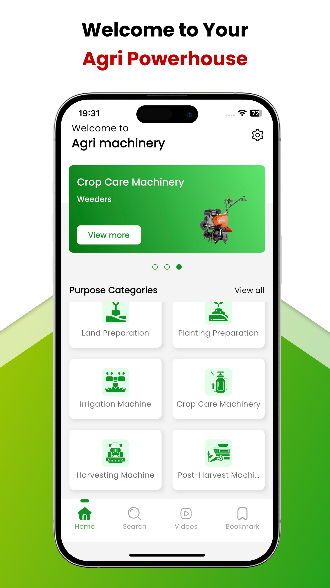
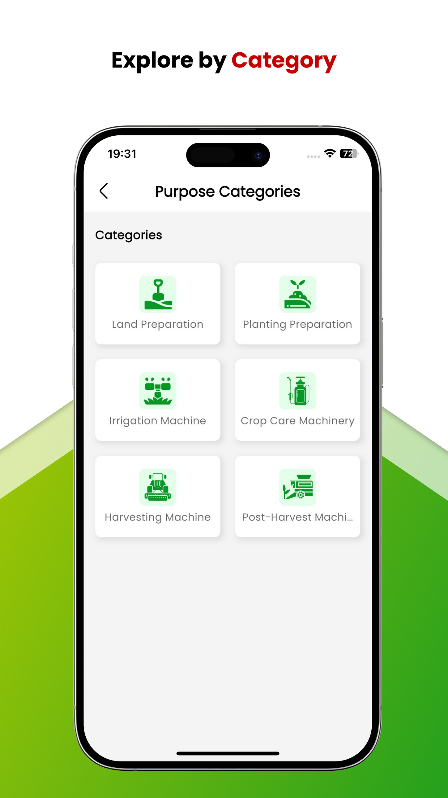
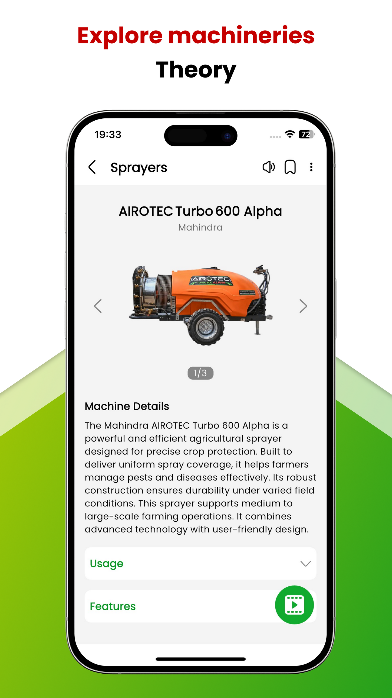
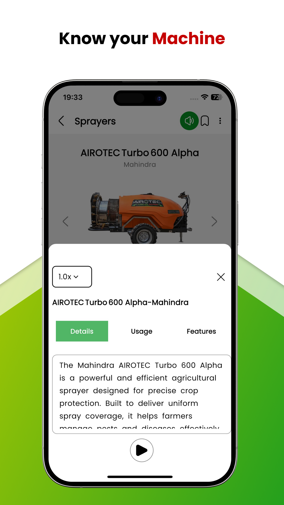
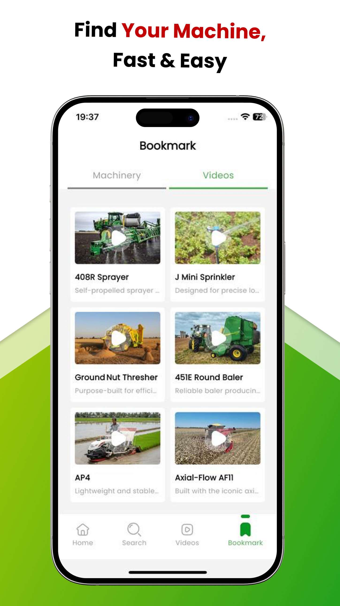
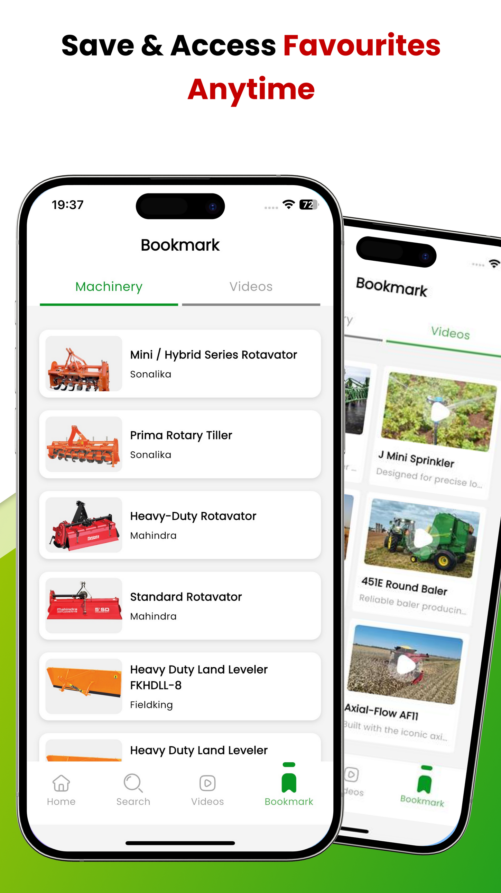
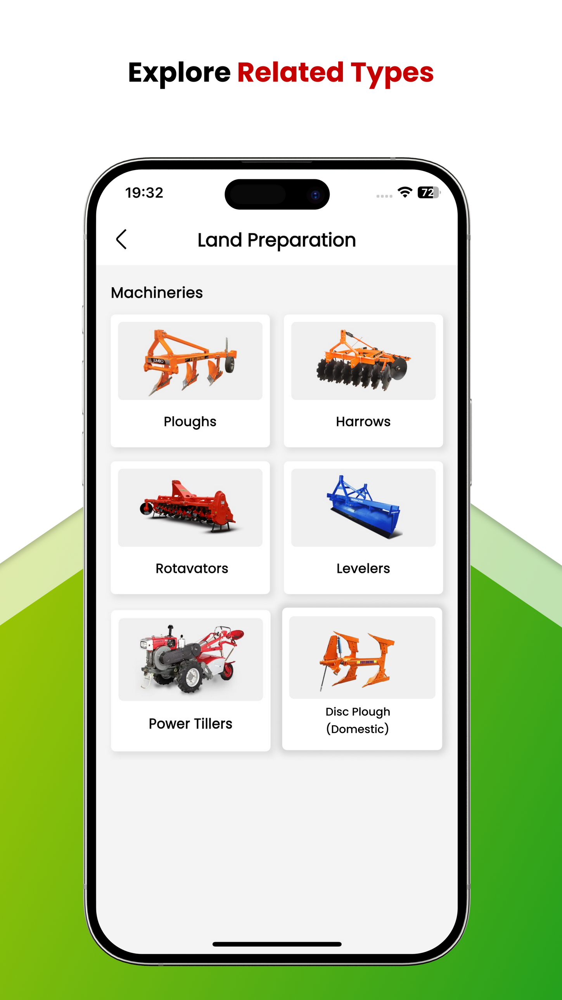

# 🚜 Agriculture Machinery App — Flutter Mobile Application Case Study

<p align="center">
  
  
  
  
  
  
</p>

---

## 📌 Project Overview

The **Agriculture Machinery App** is an educational and reference mobile application engineered to help farmers, agricultural students, and machinery operators explore agricultural equipment, technical specifications, and interactive video tutorials.

The application combines equipment cataloging with multimedia learning features:
- **Hierarchical Equipment Browsing** organized by purpose, implement type, and tractor horsepower.
- **Vertical Video Reels** for watching machinery in field operation and maintenance walkthroughs.
- **Synchronized Text-to-Speech (TTS)** for listening to operational specifications hands-free.
- **Bookmarks & Favorites** for quick field access to frequently used implements.

---

## 📱 Application Screenshots & Interface Tour

<div align="center">
  <table>
    <tr>
      <td width="33%" align="center">
        
        <br /><b>Machinery Hub & Equipment Search</b>
      </td>
      <td width="33%" align="center">
        
        <br /><b>Purpose & Implementation Categories</b>
      </td>
      <td width="33%" align="center">
        
        <br /><b>Machine Specs & TTS Trigger</b>
      </td>
    </tr>
    <tr>
      <td width="33%" align="center">
        
        <br /><b>Synchronized TTS Audio Player</b>
      </td>
      <td width="33%" align="center">
        
        <br /><b>Field Operation Video Reels</b>
      </td>
      <td width="33%" align="center">
        
        <br /><b>Saved Machinery & Bookmarks</b>
      </td>
    </tr>
  </table>

  <p align="center">
    
    <br /><b>Related Implement Types & Sub-Categories</b>
  </p>
</div>

---

## 👨‍💻 My Role & Key Contributions

**Flutter Developer**

Contributed to the core development of the Agriculture Machinery App, focusing on mobile UI architecture, video media streaming, text-to-speech audio integration, and responsive layout design:

### 1. Machinery Browsing & Cataloging
- Built categorized equipment browsing interfaces with clean cards, purpose tags, and implement badges.
- Structured technical specifications (horsepower requirements, dimensions, operation guidelines) in an accessible, readable mobile format.

### 2. Educational Video Reels Experience
- Developed a vertically scrolling reels-style video player optimized for agricultural demonstrations and equipment maintenance.
- Implemented smooth video playback controllers, buffering states, and tap-to-pause interactions.

### 3. Integrated Text-to-Speech (TTS)
- Implemented text-to-speech functionality for machine specifications, enabling operators in the field to listen hands-free.
- Engineered playback speed adjustments (0.5x, 1.0x, 1.5x, 2.0x) with play/pause sheet controls.

### 4. Bookmarks & Saved Equipment
- Implemented bookmarking and favorites functionality for saving relevant machines and video tutorials for offline or quick review.

---

## 🛠️ Technical Focus & Architecture

```
┌────────────────────────────────────────────────────────┐
│                   Flutter Presentation                  │
│       (Material 3, Custom Machinery Cards, Video Reels) │
└───────────────────────────┬────────────────────────────┘
                            │
┌───────────────────────────▼────────────────────────────┐
│                  Riverpod State Management             │
│        (StateNotifier, AsyncValue, Equipment Provider) │
└─────────────┬───────────────────────────┬──────────────┘
              │                           │
┌─────────────▼──────────────┐ ┌──────────▼──────────────┐
│       REST API Pipeline    │ │      Local Storage      │
│   (Dio/http, JSON models,  │ │  (TTS Controller,       │
│    error fallback handling)│ │   Bookmarked Machinery) │
└────────────────────────────┘ └─────────────────────────┘
```

- **Framework**: Flutter & Dart
- **State Management**: Riverpod for predictable state and scalable data flow
- **Multimedia Integration**: Hardware-accelerated video playback and native Text-to-Speech audio channels
- **Data Handling**: REST API integration with robust JSON serialization
- **Persistence**: Local caching for saved machinery and favorites

---

## 💡 Key Learnings & Engineering Outcomes

- **Multimedia User Experiences**: Integrating video controllers alongside interactive audio playback without causing memory leaks or UI stutters.
- **Content Hierarchy in Mobile UI**: Organizing dense industrial equipment data into clear, user-friendly mobile screens.
- **Scalable State Architecture**: Applying Riverpod to decouple UI widgets from asynchronous equipment data pipelines.

---

## 🔒 Project Privacy Notice

This repository documents my professional mobile engineering experience. It does not include proprietary application source code, confidential business logic, private API endpoints, credentials, or customer data.

---

## 📬 Contact & Portfolio

**Kabilan R** — Flutter & Mobile Application Developer  
- **🌐 Portfolio**: [https://kabilan-portfolio.vercel.app](https://kabilan-portfolio.vercel.app)  
- **🐙 GitHub**: [@KabilanR-Dev](https://github.com/KabilanR-Dev)  
- **💼 LinkedIn**: [linkedin.com/in/kabilan-r-91432b268](https://www.linkedin.com/in/kabilan-r-91432b268)  
- **📧 Email**: [kabilanr244@gmail.com](mailto:kabilanr244@gmail.com)
